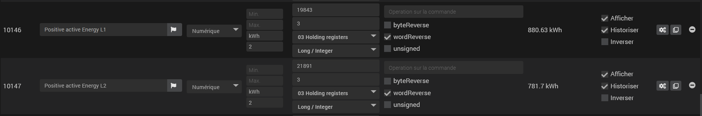
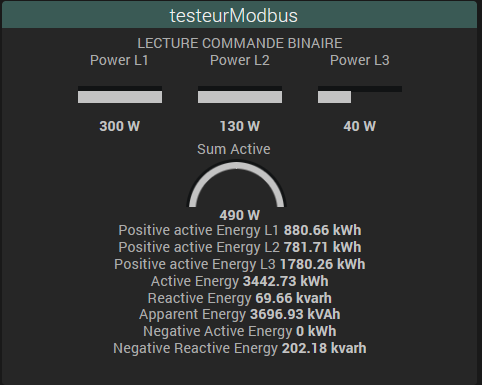

# Description

**Modbus Monitor** reads the registers of **Modbus TCP-IP** devices (energy meters, inverters, PLCs, Modbus gateways…) and turns them into Jeedom commands. It also includes a register **scanner** and **tester** to find the right addresses and decoding before you create your commands.

> **Important**
>
> The plugin is **read-only**. Writing registers is not available: a write command returns an error.
>
> Only **TCP** mode can be used. The "Modbus RTU" choice (serial link) appears in the list but is disabled.

The plugin runs **without a daemon and without dependencies**: devices are polled by a Jeedom scheduled task. It suits simple installations that do not need real time.

# Requirements

| Item | Detail |
|---|---|
| Jeedom | 4.4 or later recommended (the interface uses Jeedom 4.4 tools) |
| Device | reachable over Modbus TCP from the box (IP address, port, Unit ID) |

# Installation and configuration

1. Install the plugin from the Market, then enable it.
2. No dependency or daemon to start.
3. Open **Plugins → Home automation protocol → Modbus Monitor**.

The plugin configuration page contains legacy settings (socket port, delays between requests, retries): they are not used by the current reading. Leave them as they are.

# Equipment

Click **Add**, name the equipment, then fill in the **Equipment** tab.

| Field | Purpose |
|---|---|
| Name, Parent object, Category, Enable, Visible | usual Jeedom settings |
| Modbus type | `TCP` (only available choice) |
| Ip Device | IP address of the device or Modbus gateway (required to save) |
| Unit ID | Modbus slave identifier (required, including behind a gateway) |
| Port (optional) | Modbus TCP port, **502** by default |
| Poll cycle | reading frequency: 30 s, 1 min (default), 2 min or 5 min |
| Tester | opens the tester pre-filled with the equipment settings |

Only **enabled** equipment is polled. If reading fails, the equipment goes into *timeout* in Jeedom.

Equipment toolbar:

- **Raw information**: shows the full equipment configuration.
- **Import / Export**: saves or reloads the configuration and commands of an equipment in a JSON file (handy to duplicate an identical device).
- **Command edit mode**: switches the command table between compact and detailed view.
- **Default config**: reapplies the default widget to all commands of the equipment.
- **Export commands…** (on the right): pick commands, then **Download** a JSON file.

# Commands

A **Refresh** action command is created automatically. Other commands (one per value to read) are added in the **Commands** tab with **Add an info**, or directly from the tester.

| Setting | Purpose |
|---|---|
| Start register | decimal address of the first register |
| Number of registers | number of 16-bit registers to read (2 for a 32-bit value, 4 for 64 bits) |
| Function | `01 Coils Status`, `02 Discrete Input`, `03 Holding registers` (default), `04 Input Registers` |
| Data format | `Long / Integer` or `Float (Real4)` to get a numeric value |
| wordReverse | reverses word order (checked by default) |
| byteReverse | reverses byte order inside each word |
| unsigned | unsigned value (always positive) |
| Operation | calculation applied to the value read, e.g. `/10`, `*0.1`, `/1000+2` (operators `+ - * /`, comma accepted) |
| Display / Historize | a command that is **not displayed is not read** |

A `Float` needs at least 2 registers. The `Bits`, `String` and `None` formats are offered in the list, but periodic reading only returns a usable value with `Long / Integer` and `Float`.

For functions `01` and `02`, saving replaces the command with one command per bit (`ReadCoil_<address>` or `ReadDiscrete_<address>`).

Consecutive commands are read together, which reduces the number of requests sent to the device.

# Scan and tester

The **Scan** and **Tester** tiles on the plugin page open two tools. They reuse the settings of the open equipment.

- **Scan**: fill in the gateway (IP, port), click **Connection**, then set Slave ID, start and end register, length, function, format, operation and reversals. The table shows each register read, its value and whether a **command already exists**. A button lets you **test** a register.
- **Tester**: reads a specific address and shows **all possible interpretations** (integers, floats, reversals, text, hexadecimal). Check or uncheck Word / Byte / Unsigned until you get the right value, then **create the command** in the equipment (name, unit, history).

This is the recommended method: find the right decoding in the tester, then create the command.

# FAQ and troubleshooting

**No value comes up.**
Check the IP, the port and above all the **Unit ID**. Use **Connection** in the scan or tester to validate access. Set the plugin log to *Debug* to see the requests.

**The value is absurd (e.g. 1.5 billion instead of 230).**
Change `wordReverse`, then `byteReverse` if needed, or try `Float` instead of `Long / Integer`. The tester shows all combinations at once.

**The value seems to come from the next register.**
Some documentation counts addresses from 1. Try the address minus 1 (or plus 1) in the tester.

**A command never updates.**
Check that it is **displayed** and that start register, number of registers and format are filled in: otherwise it is skipped (warning in the log).

**A write command returns an error.**
This is expected: writing is not supported.

# Support

Forum: [Jeedom community, modbus tag](https://community.jeedom.com/tag/modbus/l/latest).

[See the changelog](./changelog)
