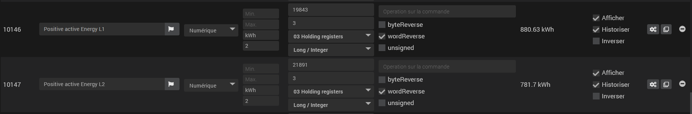
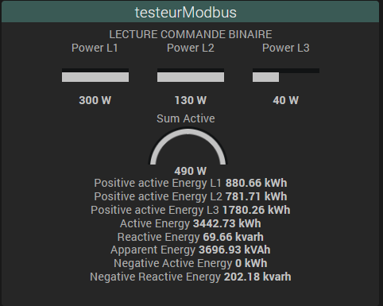

# Description

**Modbus Monitor** lit les registres d'appareils **Modbus TCP-IP** (compteurs d'énergie, onduleurs, automates, passerelles Modbus…) et les transforme en commandes Jeedom. Il intègre aussi un **scanner** et un **testeur** de registres pour trouver les bonnes adresses et le bon décodage avant de créer vos commandes.

> **Important**
>
> Le plugin fait de la **lecture** uniquement. L'écriture de registres n'est pas disponible : une commande d'écriture renvoie une erreur.
>
> Seul le mode **TCP** est utilisable. Le choix « Modbus RTU » (liaison série) apparaît dans la liste mais il est désactivé.

Le plugin fonctionne **sans démon et sans dépendance** : l'interrogation des appareils est assurée par une tâche planifiée de Jeedom. Il convient aux installations simples qui n'ont pas besoin de temps réel.

# Prérequis

| Élément | Détail |
|---|---|
| Jeedom | 4.4 ou plus récent conseillé (l'interface utilise les outils de Jeedom 4.4) |
| Appareil | accessible en Modbus TCP depuis la box (adresse IP, port, Unit ID) |

# Installation et configuration

1. Installez le plugin depuis le Market, puis activez-le.
2. Aucune dépendance ni démon à démarrer.
3. Ouvrez **Plugins → Protocole domotique → Modbus Monitor**.

La page de configuration du plugin contient des réglages hérités (port de socket, temporisations entre requêtes, tentatives) : ils ne servent pas à la lecture actuelle. Laissez-les tels quels.

# Équipements

Cliquez sur **Ajouter**, nommez l'équipement, puis renseignez l'onglet **Équipement**.

| Champ | Rôle |
|---|---|
| Nom, Objet parent, Catégorie, Activer, Visible | réglages Jeedom habituels |
| Type Modbus | `TCP` (seul choix disponible) |
| Ip Device | adresse IP de l'appareil ou de la passerelle Modbus (obligatoire pour sauvegarder) |
| Unit ID | identifiant de l'esclave Modbus (indispensable, y compris derrière une passerelle) |
| Port (optionnel) | port Modbus TCP, **502** par défaut |
| Cycle de poll | fréquence de lecture : 30 s, 1 min (défaut), 2 min ou 5 min |
| Testeur | ouvre le testeur pré-rempli avec les paramètres de l'équipement |

Seuls les équipements **activés** sont interrogés. En cas d'échec de lecture, l'équipement passe en *timeout* dans Jeedom.

Barre de l'équipement :

- **Informations brutes** : affiche la configuration complète de l'équipement.
- **Importer / Exporter** : sauvegarde ou recharge la configuration et les commandes d'un équipement dans un fichier JSON (pratique pour dupliquer un appareil identique).
- **Mode édition des commandes** : bascule le tableau des commandes entre vue compacte et vue détaillée.
- **Défaut config** : réapplique le widget par défaut sur toutes les commandes de l'équipement.
- **Exporter des commandes…** (à droite) : choisir des commandes puis **Télécharger** un fichier JSON.

# Commandes

Une commande action **Rafraichir** est créée automatiquement. Les autres commandes (une par valeur à lire) s'ajoutent dans l'onglet **Commandes** avec **Ajouter une info**, ou directement depuis le testeur.

| Paramètre | Rôle |
|---|---|
| Registre départ | adresse décimale du premier registre |
| Nb de registres | nombre de registres de 16 bits à lire (2 pour une valeur 32 bits, 4 pour 64 bits) |
| Fonction | `01 Coils Status`, `02 Discrete Input`, `03 Holding registers` (défaut), `04 Input Registers` |
| Format données | `Long / Integer` ou `Float (Real4)` pour obtenir une valeur numérique |
| wordReverse | inverse l'ordre des mots (coché par défaut) |
| byteReverse | inverse l'ordre des octets dans chaque mot |
| unsigned | valeur non signée (toujours positive) |
| Opération | calcul appliqué à la valeur lue, ex. `/10`, `*0.1`, `/1000+2` (opérateurs `+ - * /`, virgule acceptée) |
| Afficher / Historiser | une commande **non affichée n'est pas lue** |

Un `Float` demande au moins 2 registres. Les formats `Bits`, `String` et `None` sont proposés dans la liste, mais la lecture périodique ne renvoie une valeur exploitable qu'en `Long / Integer` et `Float`.

Pour les fonctions `01` et `02`, la sauvegarde remplace la commande par une commande par bit (`ReadCoil_<adresse>` ou `ReadDiscrete_<adresse>`).

Les commandes qui se suivent sont lues ensemble, ce qui réduit le nombre de requêtes envoyées à l'appareil.

# Scan et testeur

Les tuiles **Scan** et **Testeur** de la page du plugin ouvrent deux outils. Ils reprennent les paramètres de l'équipement ouvert.

- **Scan** : renseignez la passerelle (IP, port), cliquez sur **Connexion**, puis indiquez Slave ID, registre de départ et de fin, longueur, fonction, format, opération et inversions. Le tableau affiche chaque registre lu, sa valeur et indique si une **commande existe déjà**. Un bouton permet de **tester** un registre.
- **Testeur** : lit une adresse précise et affiche **toutes les interprétations** possibles (entiers, flottants, inversions, texte, hexadécimal). Cochez ou décochez Word / Byte / Unsigned jusqu'à obtenir la bonne valeur, puis **créez la commande** dans l'équipement (nom, unité, historisation).

C'est la méthode conseillée : trouver le bon décodage dans le testeur, puis créer la commande.

# FAQ et dépannage

**Aucune valeur ne remonte.**
Vérifiez l'IP, le port et surtout l'**Unit ID**. Utilisez **Connexion** dans le scan ou le testeur pour valider l'accès. Passez le log du plugin en *Debug* pour voir les requêtes.

**La valeur est absurde (ex. 1,5 milliard au lieu de 230).**
Changez `wordReverse`, puis si besoin `byteReverse`, ou essayez `Float` au lieu de `Long / Integer`. Le testeur montre toutes les combinaisons d'un coup.

**La valeur semble venir du registre voisin.**
Certaines documentations comptent les adresses à partir de 1. Essayez l'adresse moins 1 (ou plus 1) dans le testeur.

**Une commande ne se met jamais à jour.**
Vérifiez qu'elle est **affichée** et que le registre de départ, le nombre de registres et le format sont renseignés : sinon elle est ignorée (avertissement dans le log).

**Une commande d'écriture renvoie une erreur.**
C'est normal : l'écriture n'est pas prise en charge.

# Support

Forum : [community Jeedom, tag modbus](https://community.jeedom.com/tag/modbus/l/latest).

[Voir le changelog](./changelog)
