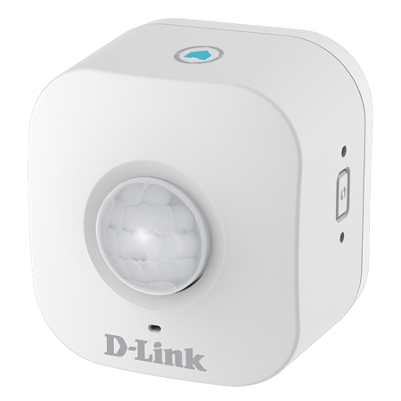

# Description

Le plugin **Dlink DCH-Motion** pilote le détecteur de mouvement Wi-Fi **D-Link DCH-S150** en local.

Il remonte la dernière détection de mouvement et permet d'activer ou désactiver la détection et de régler la sensibilité.

# Prérequis

- Un détecteur **D-Link DCH-S150** installé avec l'application **mydlink** et connecté à votre réseau Wi-Fi.
- Le détecteur doit être joignable depuis Jeedom (même réseau local).
- Une adresse IP fixe pour le détecteur (réservation DHCP sur votre box) est conseillée.
- Le **code PIN** du détecteur : il est imprimé sur l'étiquette au dos de l'appareil.

# Configuration du plugin

Aucune configuration spécifique n'est requise. Activez simplement le plugin.

# Équipements

Allez dans **Plugins > Monitoring > Dlink DCH-Motion**, puis cliquez sur **Ajouter**.

Paramètres de l'équipement :

- **Nom de l'équipement**, **Objet parent**, **Catégorie**, **Activer**, **Visible** : paramètres Jeedom habituels.
- **Type** : choisissez **Motion DCH‑S150**.
- **Adresse IP** : adresse IP du détecteur sur votre réseau.
- **Password** : le code PIN du détecteur.
- **Sélection (cron)** : fréquence d'interrogation, **1 minute** (par défaut) ou **30 secondes**.
- **cron Plugin** : tâche planifiée utilisée, **cron** (par défaut) ou **cron5**.

Cliquez sur **Sauvegarder**. Les commandes sont créées automatiquement.

Le bouton **Santé** affiche un tableau récapitulatif des équipements (modèle, IP, adresse MAC, date de création).

# Commandes

Commandes info :

- **Etat** : l'appareil répond (binaire).
- **Addresse mac** : adresse MAC du détecteur.
- **Device Name** : nom de l'appareil.
- **Sensibilité** : sensibilité actuelle, en %.
- **lastDetection** : date et heure de la dernière détection.
- **motionTstamp** : horodatage de la dernière détection.
- **motionState** : mouvement détecté ou non (binaire, historisé).

Commandes action :

- **Rafraichir** : relit les informations du détecteur.
- **Activer la détection**.
- **Désactiver la détection**.
- **Réglage Sensibilité** : curseur de 0 à 100 %.

# FAQ / Dépannage

**Aucune information ne remonte.**
Vérifiez que l'adresse IP est renseignée : un équipement sans IP est ignoré. Vérifiez que le détecteur répond sur le réseau.

**Erreur d'accès (401 - Accès non autorisé).**
Le code PIN saisi dans **Password** est incorrect. Reprenez celui de l'étiquette de l'appareil.

**Les commandes n'apparaissent pas.**
Vérifiez que le type **Motion DCH‑S150** est sélectionné, puis sauvegardez à nouveau.

**Pour aller plus loin**, passez les logs du plugin en mode Debug et consultez le log `dchmotion`.
