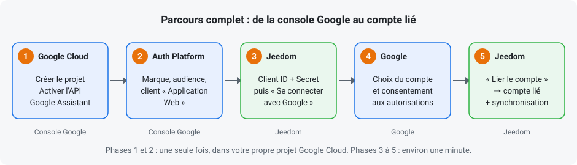
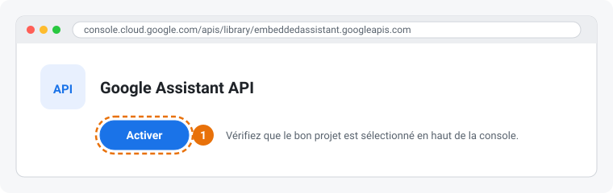
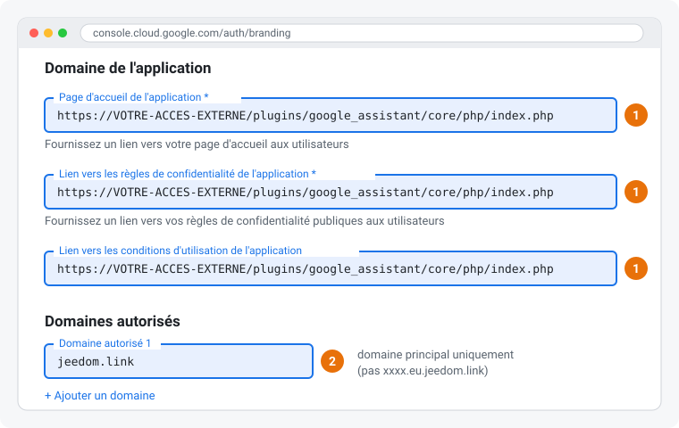
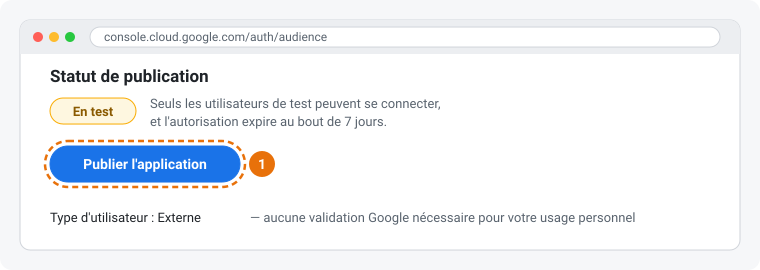
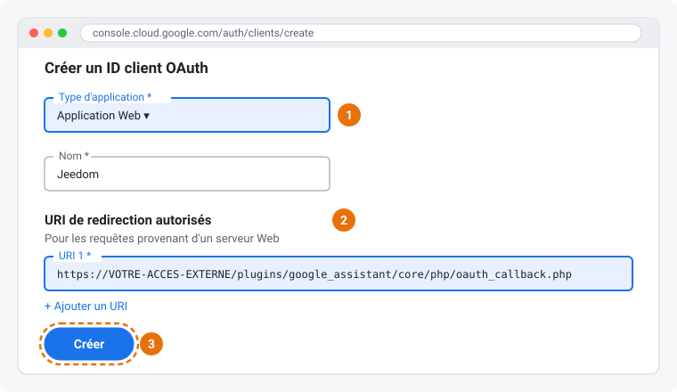
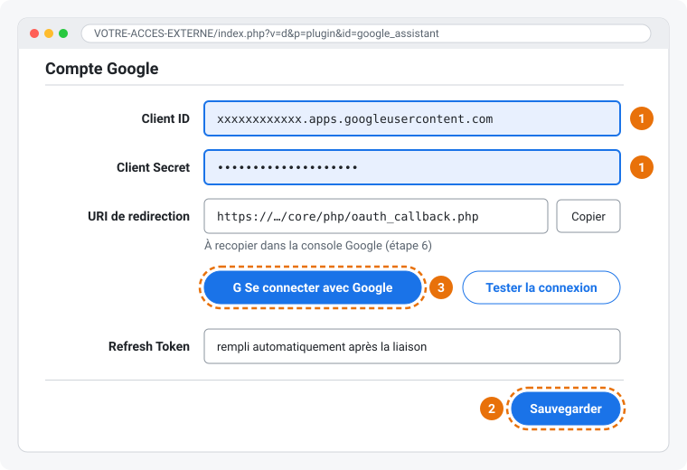
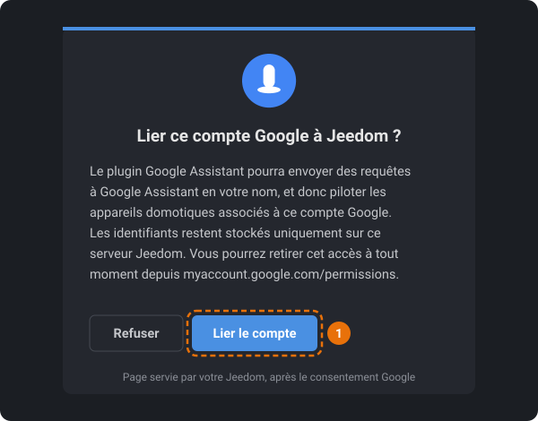

# Créer son application Google et lier son compte

Ce guide explique pas à pas comment créer, dans **votre propre projet Google Cloud**, l'application
OAuth dont le plugin a besoin, puis comment y lier votre compte Google depuis Jeedom.

Il n'existe pas d'application commune à tous les utilisateurs du plugin : chacun crée la sienne, pour
son seul compte Google. Vous en êtes à la fois le propriétaire et l'unique utilisateur, et l'auteur du
plugin n'y a jamais accès.

Comptez une quinzaine de minutes la première fois.

> **À propos des illustrations** : ce sont des schémas, pas des captures d'écran. La console Google
> change régulièrement d'apparence et peut s'afficher dans une autre langue. Les liens directs donnés à
> chaque étape mènent toujours au bon écran.

## Prérequis

- Un compte Google, celui qui utilise déjà Google Assistant / Google Home.
- Le plugin Google Assistant installé et activé dans Jeedom.
- Un **accès externe Jeedom configuré et joignable depuis Internet** : Réglages > Système >
  Configuration, onglet Réseaux. C'est lui qui permet à Google de renvoyer votre navigateur vers votre
  Jeedom à la fin de l'autorisation. Une adresse DNS Jeedom du type `https://xxxx.eu.jeedom.link`
  convient.

> Sans accès externe, cette méthode n'est pas utilisable : suivez la procédure manuelle décrite dans
> la [documentation principale](./) (section « Procédure de secours »).

> **Astuce : l'assistant intégré au plugin.** Dans **Plugins > Communication > Google Assistant > Configuration**,
> le bouton **Assistant de configuration Google** reprend ces étapes avec les **valeurs réelles de
> votre Jeedom** (URI de redirection, page publique, domaine autorisé…), chacune avec un bouton
> **Copier**, et des liens qui ouvrent directement votre projet Google Cloud. Ce guide reste utile
> pour le détail de chaque écran.

### Les deux adresses dont vous aurez besoin

Dans les exemples ci-dessous, remplacez `VOTRE-ACCES-EXTERNE` par l'adresse de votre accès externe
Jeedom (par exemple `xxxx.eu.jeedom.link`).

| Adresse | Où la trouver | À quoi elle sert |
|---|---|---|
| `https://VOTRE-ACCES-EXTERNE/plugins/google_assistant/core/php/oauth_callback.php` | Page Configuration du plugin, champ **« URI de redirection »** (bouton **Copier**) | Adresse de retour après l'autorisation Google (étape 6) |
| `https://VOTRE-ACCES-EXTERNE/plugins/google_assistant/core/php/index.php` | Construite à partir de votre accès externe | Page d'accueil, confidentialité et conditions d'utilisation de votre application (étape 4) |

Copiez de préférence l'URI de redirection depuis le plugin, avec le bouton **Copier** : Google exige
qu'elle soit identique au caractère près.

### Liens directs vers la console Google

Ces liens ouvrent l'écran demandé dans le projet **actuellement sélectionné** en haut de la console :
vérifiez que c'est bien le vôtre avant de modifier quoi que ce soit.

| Page de la console | Lien | Utilisation dans ce guide |
|---|---|---|
| API Google Assistant | [apis/library/embeddedassistant.googleapis.com](https://console.cloud.google.com/apis/library/embeddedassistant.googleapis.com) | Étape 2 : activer l'API |
| Branding | [auth/branding](https://console.cloud.google.com/auth/branding) | Étapes 3 et 4 : initialisation, liens et domaine autorisé |
| Audience | [auth/audience](https://console.cloud.google.com/auth/audience) | Étape 5 : publier l'application |
| Clients | [auth/clients](https://console.cloud.google.com/auth/clients) | Étape 6 : créer le client « Application Web » |
| Accès aux données (*Data access*) | [auth/scopes](https://console.cloud.google.com/auth/scopes) | Rien à faire (voir après l'étape 6) |
| Validation (*Verification center*) | [auth/verification](https://console.cloud.google.com/auth/verification) | Rien à faire (voir après l'étape 6) |
| Identifiants (ancien menu « API et services ») | [apis/credentials](https://console.cloud.google.com/apis/credentials) | Autre accès aux clients OAuth existants |

---

## Étape 1 — Créer le projet Google Cloud

1. Ouvrez la [console Google Cloud](https://console.cloud.google.com/).
2. Cliquez sur le sélecteur de projet en haut de l'écran, puis sur **Nouveau projet**.
3. Donnez-lui un nom (par exemple `Jeedom Google Assistant`), puis cliquez sur **Créer**.
4. Une fois le projet créé, vérifiez qu'il est bien **sélectionné** dans la barre du haut. Toutes les
   étapes suivantes s'appliquent au projet sélectionné.

## Étape 2 — Activer l'API Google Assistant

1. Ouvrez la page de l'[API Google Assistant](https://console.cloud.google.com/apis/library/embeddedassistant.googleapis.com).
2. Vérifiez que le bon projet est sélectionné, puis cliquez sur **Activer**.

## Étape 3 — Initialiser Google Auth Platform

1. Ouvrez la page [Google Auth Platform](https://console.cloud.google.com/auth/branding).
2. Si la plateforme n'est pas encore configurée, cliquez sur **Commencer** (*Get started*) :
   - **Informations sur l'application** : saisissez un nom (par exemple `Jeedom`) et choisissez votre
     adresse e-mail comme adresse d'assistance. Ce nom s'affichera sur l'écran de consentement Google.
   - **Audience** : choisissez **Externe**.
   - **Coordonnées** : saisissez votre adresse e-mail.
   - Lisez le règlement sur les données utilisateur des services Google API, cochez la case si vous
     l'acceptez, puis cliquez sur **Continuer** et **Créer**.

## Étape 4 — Renseigner la marque et le domaine autorisé

Ouvrez la page [Branding](https://console.cloud.google.com/auth/branding) (menu de gauche).

1. Dans **Domaine de l'application**, renseignez les trois liens avec la **page publique du plugin** :
   `https://VOTRE-ACCES-EXTERNE/plugins/google_assistant/core/php/index.php`
   - Page d'accueil de l'application ;
   - Lien vers les règles de confidentialité de l'application ;
   - Lien vers les conditions d'utilisation de l'application.

   Cette page, fournie par le plugin, regroupe la présentation, les règles de confidentialité et les
   conditions d'utilisation de votre application.
2. Dans **Domaines autorisés**, ajoutez le **domaine principal** de votre accès externe.

   > Google n'accepte ici que des domaines principaux, jamais un sous-domaine : saisir l'adresse
   > complète de votre Jeedom est refusé. Ne gardez que les deux dernières parties du nom :
   >
   > | Adresse de votre accès externe | Domaine autorisé à saisir |
   > |---|---|
   > | `https://xxxx.eu.jeedom.link` | `jeedom.link` (ni `xxxx.eu.jeedom.link`, ni `eu.jeedom.link`) |
   > | `https://jeedom.mondomaine.fr` | `mondomaine.fr` |
   >
   > Pour un domaine national à deux niveaux, comme `.co.uk`, gardez les trois dernières parties
   > (`mondomaine.co.uk`).
3. Cliquez sur **Enregistrer**.

## Étape 5 — Publier l'application

Ouvrez la page [Audience](https://console.cloud.google.com/auth/audience) (menu de gauche).

1. Dans **Statut de publication**, cliquez sur **Publier l'application** et confirmez.

> **Pourquoi publier ?** Tant que l'application reste « En test », Google invalide l'autorisation au
> bout de **7 jours** : il faudrait relier le compte chaque semaine.
>
> Publier ne rend pas votre application publique et ne demande **aucune validation Google** : elle
> reste dans votre projet, et seul votre compte y sera lié. Google affichera simplement un
> avertissement « application non validée » lors de la liaison (voir l'étape 8).
>
> Si vous préférez tout de même la laisser en test, ajoutez votre adresse Google dans **Utilisateurs
> de test**, sinon la connexion sera refusée.

## Étape 6 — Créer le client OAuth « Application Web »

Ouvrez la page [Clients](https://console.cloud.google.com/auth/clients) (menu de gauche), puis
cliquez sur **Créer un client**. Les clients sont aussi visibles dans l'ancien menu
[API et services > Identifiants](https://console.cloud.google.com/apis/credentials) : c'est le même
client, vous n'avez pas à le créer deux fois.

1. **Type d'application** : choisissez **Application Web**.
2. **Nom** : par exemple `Jeedom`.
3. Dans **URI de redirection autorisés**, cliquez sur **Ajouter un URI** et collez l'URI de redirection
   copiée depuis le plugin :
   `https://VOTRE-ACCES-EXTERNE/plugins/google_assistant/core/php/oauth_callback.php`
4. Cliquez sur **Créer**.

> **Attention à l'URI** : ce n'est pas un exemple, c'est l'adresse exacte à utiliser. Elle doit être
> strictement identique à celle affichée dans le plugin : même `https`, même adresse, aucun `/` final,
> aucun paramètre après `.php`. La moindre différence provoque une erreur `redirect_uri_mismatch`.

5. Google affiche alors le **Client ID** et le **Client Secret**. **Notez-les tout de suite** : le
   secret peut ne plus être consultable une fois la fenêtre fermée.

> Un client tout juste créé est généralement actif en quelques minutes, mais Google indique que cela
> peut prendre jusqu'à cinq heures. Si la liaison échoue juste après la création, réessayez plus tard.

### À savoir : les pages « Accès aux données » et « Validation »

Le menu de Google Auth Platform contient deux autres pages. **Vous n'avez rien à y faire.**

- **[Accès aux données](https://console.cloud.google.com/auth/scopes)** (*Data access*) : cette page
  permet de déclarer à l'avance les autorisations (scopes) que l'application demandera. C'est inutile
  ici : le plugin demande lui-même, à chaque connexion, les autorisations dont il a besoin, et
  Google les affiche sur l'écran de consentement (étape 8) :
  - `https://www.googleapis.com/auth/assistant-sdk-prototype` : utiliser Google Assistant ;
  - `https://www.googleapis.com/auth/gcm` : envoyer des informations à vos appareils ;
  - `https://www.googleapis.com/auth/cloud-platform` et
    `https://www.googleapis.com/auth/generative-language.retriever` : utilisées uniquement par la
    reformulation Gemini, optionnelle.
- **[Validation](https://console.cloud.google.com/auth/verification)** (*Verification center*) : cette
  page sert à faire valider l'application par Google, ce qui n'est nécessaire que pour une application
  proposée au public. Pour votre usage personnel, ne lancez aucune démarche : l'application fonctionne
  sans validation, avec simplement l'avertissement « Google n'a pas validé cette application » lors de
  la liaison.

## Étape 7 — Renseigner les identifiants dans Jeedom

Ouvrez **Plugins > Communication > Google Assistant > Configuration**.

1. Collez le **Client ID** et le **Client Secret**.
2. Cliquez sur **Sauvegarder**. C'est indispensable : le bouton de connexion utilise les identifiants
   enregistrés, pas ceux simplement saisis.
3. Ne cliquez pas encore sur « Se connecter avec Google » : lisez d'abord l'étape 8.

Le champ **Refresh Token** reste vide pour l'instant : le plugin le remplira lui-même à la fin de la
liaison.

## Étape 8 — Lier votre compte Google

1. **Ouvrez Jeedom via votre accès externe** (`https://VOTRE-ACCES-EXTERNE`) et connectez-vous en tant
   qu'**administrateur**. La validation finale exige une session administrateur ouverte sur cette même
   adresse : une session ouverte sur l'adresse locale (par exemple `http://192.168.x.x`) ne suffit pas.
2. Sur la page Configuration du plugin, cliquez sur **Se connecter avec Google**. Un nouvel onglet
   s'ouvre ; si votre navigateur le bloque, autorisez les fenêtres pop-up pour Jeedom ou utilisez le
   lien affiché par le plugin.
3. Choisissez le compte Google à lier.
4. Google affiche **« Google n'a pas validé cette application »**. C'est normal pour une application
   personnelle : cliquez sur **Paramètres avancés**, puis sur **Accéder à Jeedom (non sécurisé)**, ou
   au nom que vous avez donné à l'application à l'étape 3.
5. Google détaille les autorisations demandées (utilisation de Google Assistant, envoi
   d'informations à vos appareils, et accès à Gemini pour la reformulation optionnelle). Si des cases à cocher sont proposées, **cochez-les toutes**, puis
   cliquez sur **Continuer**.
6. Votre navigateur revient sur votre Jeedom, sur la page **« Lier ce compte Google à Jeedom ? »**.
   Cliquez sur **Lier le compte**.

7. Un message de succès s'affiche, puis vous êtes **ramené automatiquement** sur la page du plugin
   après quelques secondes (ou tout de suite avec **Terminer**). La synchronisation des équipements
   TTS Cast se lance alors, et une notification indique le nombre d'équipements créés.
   **Ne rechargez pas** la page de résultat.
8. Vérifiez la liaison avec le bouton **Tester la connexion** de la page Configuration.

> **Langue du compte Google** : si votre compte Google est réglé sur une langue non prise en charge
> par l'API Google Assistant (l'écran d'autorisation Google s'affiche alors dans cette langue),
> l'autorisation peut échouer sans message clair. Choisissez une
> [langue prise en charge](https://developers.google.com/assistant/sdk/reference/rpc/languages) en
> bas de la page d'erreur Google, puis recommencez.

---

## Dépannage

| Symptôme | Cause probable | Solution |
|---|---|---|
| Erreur Google `redirect_uri_mismatch` | L'URI déclarée à l'étape 6 diffère de celle envoyée par le plugin | Comparez caractère par caractère l'URI de la console avec le champ **« URL générée »** de la page Configuration (paramètre `redirect_uri`), puis corrigez la console |
| « Renseignez et enregistrez le Client ID avant de vous connecter » | Identifiants saisis mais pas sauvegardés | Cliquez sur **Sauvegarder**, puis recommencez |
| « Accès externe Jeedom non configuré » | Accès externe absent ou incomplet | Configurez-le dans Réglages > Système > Configuration, onglet Réseaux, ou utilisez la procédure manuelle |
| « Session administrateur requise pour valider la liaison » | Pas de session administrateur sur l'adresse externe | Connectez-vous à Jeedom sur cette adresse dans un autre onglet, puis recliquez sur **Lier le compte** dans les 5 minutes |
| « Demande expirée ou déjà traitée » ou « Jeton de sécurité OAuth invalide ou expiré » | Plus de 5 minutes entre deux étapes, page rechargée ou retour arrière | Relancez **Se connecter avec Google** sans recharger ni revenir en arrière |
| « Google n'a renvoyé aucun refresh_token » | Google considère l'accès comme déjà accordé | Retirez l'accès sur [myaccount.google.com/permissions](https://myaccount.google.com/permissions), puis relancez la connexion |
| La liaison est à refaire toutes les semaines | Application restée « En test » | Publiez l'application (étape 5), puis reliez le compte une dernière fois |
| Google refuse le domaine dans **Domaines autorisés** | Un sous-domaine a été saisi (par exemple `xxxx.eu.jeedom.link`) | Saisissez uniquement le domaine principal : `jeedom.link` (étape 4) |
| « Google n'a pas validé cette application » | Application personnelle non soumise à validation | Normal : **Paramètres avancés > Accéder à…** (étape 8) |
| Les commandes n'ont aucun effet | Requête mal comprise par Google Assistant | Vérifiez dans [Mon activité Google](https://myactivity.google.com/myactivity) que la requête arrive bien. Simplifiez la formulation, par exemple « allume lumière salon » plutôt qu'une phrase complète |

## Limites connues

- **Un seul compte Google par Jeedom** : les identifiants sont communs à tous les équipements du plugin.
- Certaines limites viennent de l'API Google Assistant elle-même et ne peuvent pas être corrigées
  par le plugin. L'intégration Home Assistant, qui utilise la même API, signale notamment :
  - les routines Google ne se déclenchent pas ;
  - la lecture de médias ne fonctionne pas, à quelques exceptions près (actualités, podcasts, bruit
    blanc, bruit de pluie) ;
  - les commandes qui exigent une vérification par Voice Match ne fonctionnent pas ;
  - les annonces vers une pièce précise fonctionnent souvent mal dans une langue autre que l'anglais.

## Retirer l'accès

- Côté Google : retirez l'autorisation sur
  [myaccount.google.com/permissions](https://myaccount.google.com/permissions).
- Côté Jeedom : videz les identifiants dans la page Configuration du plugin, ou désinstallez le plugin.
- Pour supprimer complètement l'application : supprimez le projet dans la
  [console Google Cloud](https://console.cloud.google.com/).
